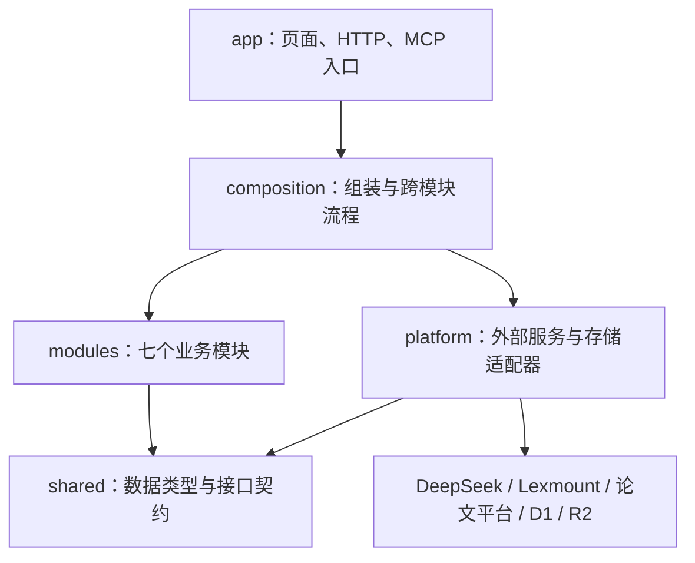

# MedAtlas 模块地图

先读这份地图，再进入对应目录。系统采用单体应用内的模块化结构：一次部署，业务模块可以单独测试，外部服务通过接口接入。没有拆成需要独立运维的微服务。

## 七个业务模块

| 模块 | 负责什么 | 主要入口 | 独立测试 |
| --- | --- | --- | --- |
| `catalog` 文献目录 | 汇总检索、去重、排序、发表平台与概述占位 | `service.ts`、`papers.ts` | `npm run test:module -- catalog` |
| `reading` 论文阅读 | 中文概述、摘要翻译、结构化精读与原文证据 | `service.ts`、`summary.ts` | `npm run test:module -- reading` |
| `atlas` 研究星图 | 三维展示、论文关系与相关节点选择 | `scene.tsx`、`relations.ts` | `npm run test:module -- atlas` |
| `repositories` 代码仓库 | 从论文发现链接、静态检查、中文评价 | `workflow.ts` | `npm run test:module -- repositories` |
| `ideas` 研究选题 | 补充检索计划、候选筛选、方案生成、引用校验与导出 | `service.ts`、`evidence.ts`、`schema.ts` | `npm run test:module -- ideas` |
| `workspace` 个人工作区 | 论文收藏、已保存选题查询、PDF 解析与私有文件生命周期 | `saved-items.ts`、`documents.ts` | `npm run test:module -- workspace` |
| `automation` 后台任务 | 任务分派与单次执行错误隔离 | `runner.ts` | `npm run test:module -- automation` |

每个目录中的 `ui/` 只承载本模块的展示组件。`app/components/atlas-app.tsx` 保留跨页面导航和交互状态；选题历史、收藏变更等 HTTP 流程仍由路由协调，不是所有页面状态都抽象成服务。

## 依赖方向



- `shared/ports.ts` 定义模型、网页读取、文献源和论文存储接口；`shared/models.ts` 定义业务数据。
- `composition/providers.ts` 是服务选择入口；其他 composition 文件把接口注入业务服务。后台批量补全、数据库租约和跨模块流程集中在 `composition/jobs/`。
- `platform/ai`、`web`、`sources`、`storage`、`identity` 分别封装模型、抓取、论文来源、存储和身份。密钥只在服务端适配器和装配层读取。
- 业务模块不能导入 `platform`、`composition`、`app`、数据库实现或服务端运行时；共享层不能反向依赖业务；适配器不能导入装配层。
- `npm run check:architecture` 检查上述导入边界及循环依赖。它检查静态导入与字符串形式的动态导入，不替代代码评审。

## 如何替换服务

例如替换模型：实现 `JsonModel`，在 `composition/providers.ts` 中替换绑定，阅读与选题模块无需知道新服务的 API Key 或请求格式。

```ts
import type { JsonModel } from "./shared/ports";
import { createReadingService } from "./modules/reading/service";

const anotherModel: JsonModel = async (system, input, options) => {
  // 在服务端适配器调用新供应商，返回解析后的 JSON；错误应抛出。
  return callYourProvider(system, input, options);
};
const reading = createReadingService({
  model: anotherModel,
  web: yourWebReader,
  fullText: yourFullTextReader,
});
```

这是接口示意，`callYourProvider` 等由新适配器实现。模型输出仍须经过业务层结构与引用校验，不能因为换供应商而跳过验证。

- 增加论文源：实现 `PaperSource`，加入 `composition/catalog.ts` 的源列表。单个源失败会返回警告，不丢弃其他源结果。
- 替换网页抓取：实现 `WebReader` 的 `extract` 与 `dumpDom`，保持来源 URL 等追溯字段。
- 替换文件存储：实现 `modules/workspace/documents.ts` 中的 `PrivateFiles` 和 `UploadRepository`，在 `composition/workspace.ts` 重新装配。
- 更换整个托管平台仍需迁移登录、D1/R2、HTTP 路由及任务调度；本次解耦不意味着无需迁移即可跨平台部署。

## 失败处理与数据边界

检索源独立失败；网页失败时精读可退回摘要并标明来源；没有可靠原文时不编造结果。模型生成有结构、引用及证据检查，修订次数有上限。仓库请求失败记为无法确认，不解释为文件缺失。

PDF 操作先检查所属用户。上传文件或元数据失败时尝试清理已写入文件；清理失败仍可能需要运维处理。删除先处理文件，再删除记录，以便失败后重试。论文收藏幂等，选题只有明确收藏才出现在工作区；生成历史不是收藏。后台任务失败通过结构化结果返回，不等同于持久队列或自动重试调度器。

## 验证方式与范围

```sh
npm test                         # 边界检查 + 七个模块及平台适配器测试
npm run test:module -- ideas      # 只运行选题模块
npm run test:module -- workspace  # 收藏、PDF 解析、权限、存储失败与实际路由回归
npm run typecheck
npm run build
```

模块测试使用替代模型、网页服务和存储，验证接口可替换及失败路径。工作区路由测试执行真实路由和数据库 schema，使用内存 SQLite、模拟 R2 与身份，覆盖越权、删除、上传失败清理、限额和收藏语义。PDF 测试执行真实 PDF 解析器。

测试不调用付费模型，不证明真实供应商持续可用或生成结果学术正确。当前环境无法运行 Cloudflare 的本地 workerd，因此未完成登录浏览器端到端验证；生产打包与类型检查是另外的验证步骤。三维模块测试覆盖关系逻辑，不能代替 WebGL 视觉检查。
