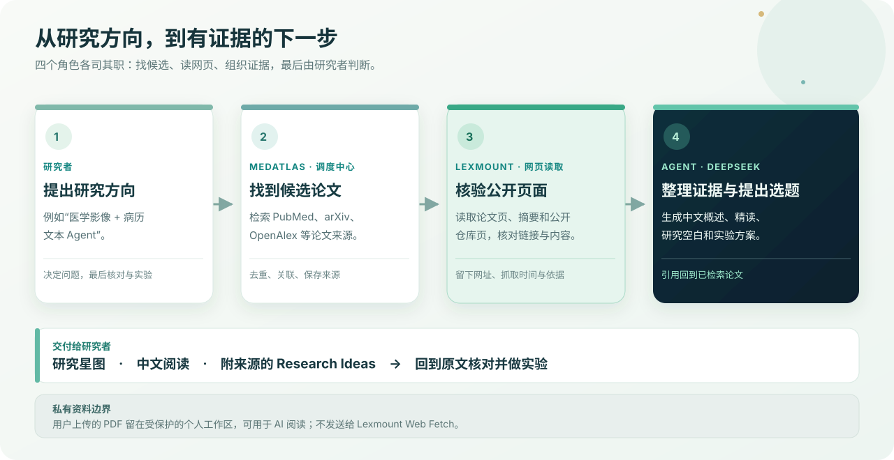

# MedAtlas · 医学 AI 文献地图

**从一个研究方向出发，找到论文、读懂证据，再形成可以继续验证的研究选题。**

[在线体验 MedAtlas](https://medatlas-research-2026.zhouxiuzhuang.chatgpt.site) · [了解模块设计](docs/architecture.md) · [查看运行说明](docs/operations.md) · [个人服务器部署](docs/self-hosting.md)

MedAtlas 面向刚进入医学 AI 方向的研究者。首版聚焦医学影像、病历文本与 Agent：把分散的论文放进可探索的研究星图，提供中文阅读辅助，并根据已有工作生成附有证据链的 Research Ideas。

## 一张图看懂它怎么工作



**Lexmount 负责“看见网页”**：读取公开论文页、核对论文与仓库链接，记录来源和抓取时间。**Agent 负责“理解与组织”**：结合检索结果和可追溯内容，借助 DeepSeek 生成中文概述、精读与研究方案。最终的学术判断和实验验证仍由研究者完成。

> 图中的 Agent 指网站运行时的自动化研究流程。Codex 用于开发这个项目，不是网站运行时的论文来源。

## 你可以做什么

| 研究步骤 | 网站提供的能力 |
| --- | --- |
| 找论文 | 按研究方向检索 PubMed、arXiv、OpenAlex 等来源；Lexmount 优先读取公开网页并核验候选论文。 |
| 看脉络 | 在研究星图中按时间和方向探索论文，并查看相关工作。 |
| 读证据 | 查看中文概述、摘要译文和结构化精读；标明分析依据是摘要还是开放全文。 |
| 查代码 | 找到公开仓库后，静态检查 README、许可证、依赖、代码入口等，并展示可核对的证据。 |
| 想选题 | 补查相近工作，逐张生成包含研究空白、假设、实验方案和引用的 Research Ideas。 |
| 继续研究 | 登录后收藏论文、标记已阅读、导入论文链接或 PDF，并保存选题。 |

研究方向可以切换并保留历史标签。没有可靠全文时，阅读结果会明确标为“仅基于摘要”；代码评价也会标明**未经实际运行复现**。AI 生成的选题是待验证假设，不能直接视为临床结论。

## 技术结构

项目是一个模块化的服务端网站，不需要分别部署多个微服务。

| 目录 | 作用 |
| --- | --- |
| [`app/`](app/) | 页面、交互入口、HTTP 与 MCP 路由 |
| [`modules/`](modules/) | 文献目录、阅读、星图、仓库、选题、工作区、后台任务七个业务模块 |
| [`composition/`](composition/) | 跨模块流程与服务组装 |
| [`platform/`](platform/) | Lexmount、DeepSeek、论文平台、身份与存储适配 |
| [`shared/`](shared/) | 共享模型、接口和纯工具 |
| [`db/`](db/) 与 [`drizzle/`](drizzle/) | 数据库 schema 与迁移 |
| [`tests/`](tests/) | 模块与路由测试 |

模块依赖方向、可替换接口和失败处理见[模块地图](docs/architecture.md)；数据来源、后台任务和配置见[运行说明](docs/operations.md)。

## 本地开发

需要 **Node.js 22.13+**；本地预览还需要能运行 Cloudflare workerd 的环境。按 [`.env.example`](.env.example) 配置服务端环境变量，不要把真实密钥提交到仓库。

```sh
npm ci
npm run dev
```

常用检查：

```sh
npm run typecheck
npm test
npm run test:module -- ideas
npm run build
```

`npm test` 检查模块边界、循环依赖与模块行为；`npm run db:generate` 只在修改数据库 schema 后运行。线上密钥放在部署平台的服务端 Secret 中。测试覆盖不能代替真实论文核查、WebGL 视觉检查或临床验证。
